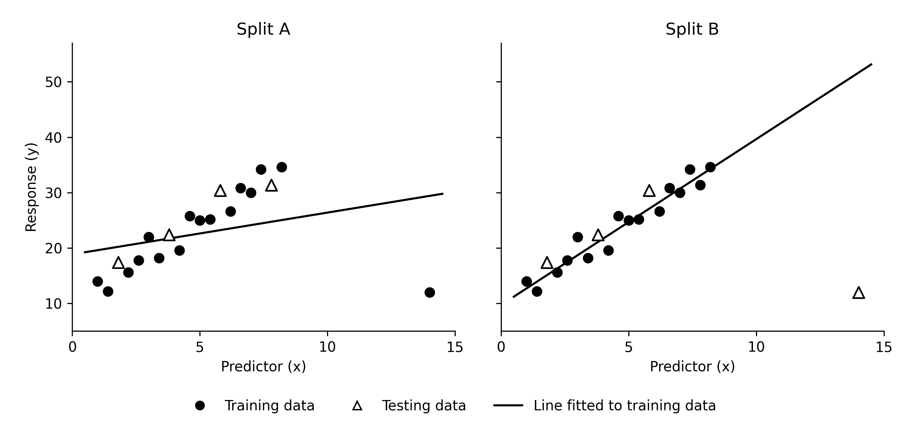

```{r}
#| echo: false
library(tidyverse)
```


\newcommand{\blank}{\rule{2.5cm}{0.15mm}}

**Team members**:

## Part 1 – Choosing the right model

For each scenario below:

1. Identify the response variable.
2. Identify the variable type for the response variable.
3. Identify whether linear or logistic regression would be an appropriate model.
4. Identify whether RMSE or Accuracy should be used to assess predictive performance of the model.

### Question 1

Predicting the time a student spends studying per week using: their major, number of classes, and GPA.

Response variable:

Response variable type:

Regression model: 

Evaluation metric:


### Question 2

Predicting whether a customer will cancel their subscription using: their monthly subscription cost and subscription type.

Response variable:

Response variable type:

Regression model: 

Evaluation metric:


### Question 3

Using humidity and wind speed to predict daily temperature.

Response variable:

Response variable type:

Regression model: 

Evaluation metric:

### Question 4

Using attendance, major, and hours studied to predict if a student will pass or fail a course.

Response variable:

Response variable type:

Regression model: 

Evaluation metric:

### Question 6

Fill in the blanks:

For continuous response variables (or at least discrete numeric response variables that can take many values), ________________ regression is appropriate and we can compute ___________________ to assess predictive performance of our model. A **larger** / **smaller** value of this is better. (circle one)

For binary response variables, ________________ regression is appropriate and we can compute ___________________ to assess predictive performance of our model. A **larger** / **smaller** value of this is better. (circle one)

## Understanding predictions

### Question 7

a. A linear regression model predicts (circle one): **value of $y_i$** / **log odds of $y_i$**

b. A logistic regression model predicts (circle one):  **value of $y_i$** / **log odds of $y_i$**

### Question 8

A logistic regression model predicts that a customer has a 0.70 probability of canceling their subscription.

a. What are the two possible values of the response variable for this customer?

\vspace*{0.5cm}

b. Explain what the predicted probability means in context.

\newpage


### Question 9

Suppose we fit the logistic regression model from question 2 with the training data and calculate predicted probability of a cancellation for the testing data.

```{r}
#| echo: true
#| eval: false
cancellation_model <- glm(
  canceled ~ monthly_cost + subscription_type,
  data = subscription_train,
  family = "binomial"
)

testing_predictions <- subscription_test |>
  mutate(
    pred_cancel_prob = predict(
      cancellation_model,
      newdata = subscription_test,
      type = "response"
    )
  )
```

```{r}
#| echo: false
data.frame(
  custmer_id = 1:10,
  pred_cancel_prob = c(0.45, 0.85, 0.20, 0.60, 0.10, 0.41, 0.70, 0.30, 0.7, 0.99),
  canceled = c(
    "Canceled", "Canceled", "Not Canceled", "Not Canceled", "Not Canceled", "Canceled", "Canceled", "Not Canceled", "Not Canceled", "Canceled"
  ),
  predicted_outcome = "",
  correct_prediction = ""
) |>
  knitr::kable(
    digits = 2,
    col.names = c(
      "Customer ID",
      "Predicted probability of cancellation",
      "Actual outcome",
      "Predicted outcome",
      "Correct prediction?"
    )
  )
```

A. Fill in the table using a cutoff of 0.5 to decide for each customer if we would predict they cancelled their subscription or not. Record if it was an accurate prediction.

B. Calculate prediction accuracy for this model on our testing dataset.

\newpage

\vspace*{-1cm}

C. Now suppose your cutoff was 0.4. What would change from parts A and B?

\vspace*{0.5in}

D. Write out the estimated model for predicting whether or not a customer will cancel their subscription using the output below.

```{r}
#| eval: false
#| echo: true
tidy(cancellation_model)
```

```{.cell-output .cell-output-stdout}
# A tibble: 4 × 5
  term                      estimate std.error statistic p.value
  <chr>                        <dbl>     <dbl>     <dbl>   <dbl>
1 (Intercept)                  -2.00      0.50      -4.00 0.0000633
2 monthly_cost                  0.08      0.02       4.00 0.0000633
3 subscription_typeStandard    -0.60      0.30      -2.00 0.0455
4 subscription_typePremium     -1.20      0.40      -3.00 0.00270
```

\vspace*{-1cm}

### Question 10

For this question let's suppose we were doing linear regression to fit a predictive model for some response variable and predictor variable.


\vspace*{-0.5cm}

{width=70% fig-align="center"}


\vspace*{-0.5cm}

Suppose two teams use the same dataset, fit a linear model with the same predictor, and use the same metric to evaluate predictive performance. Each team randomly assigns 80% of the observations to training and 20% to testing, but with different seeds.

A. Which team do you think would have better predictive performance (RMSE) on their testing data? Explain.

\vspace*{0.5in}


B. How could we change our training and testing process so that our assessment of predictive performance depends less on one particular random split? Generate ideas and describe a possible approach and explain why you think it would help.


