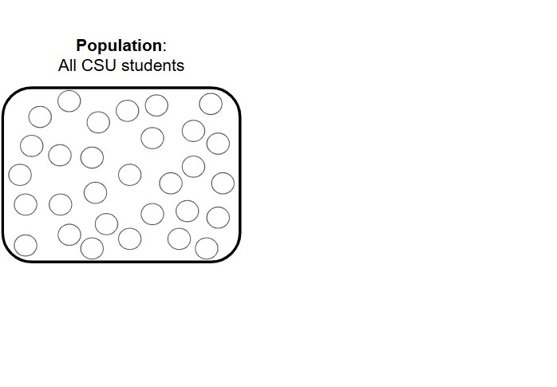
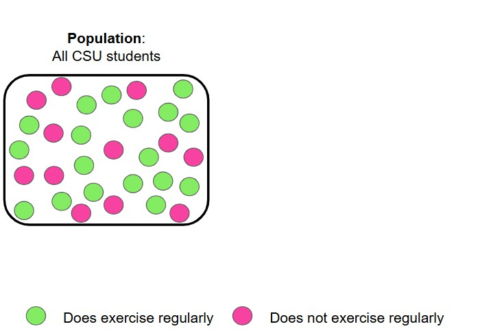
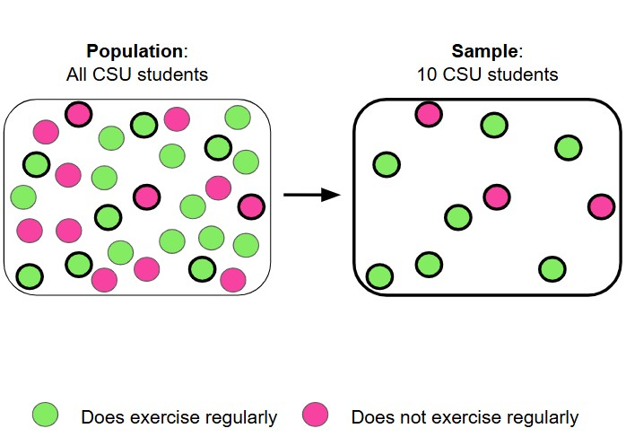
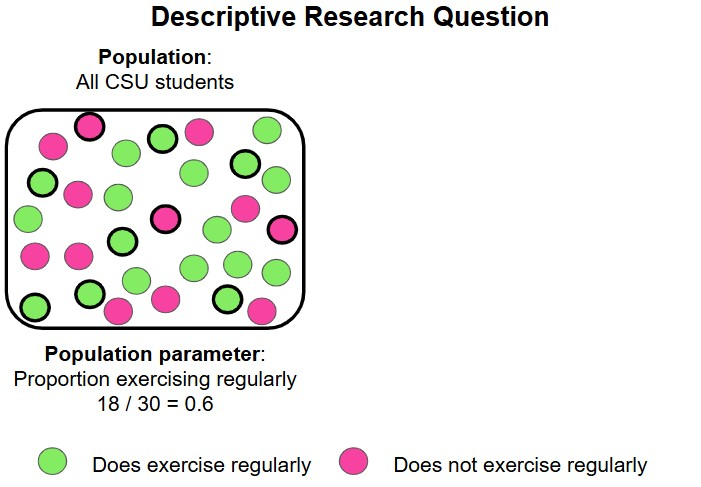
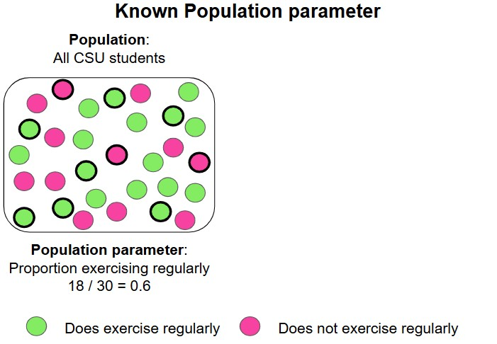
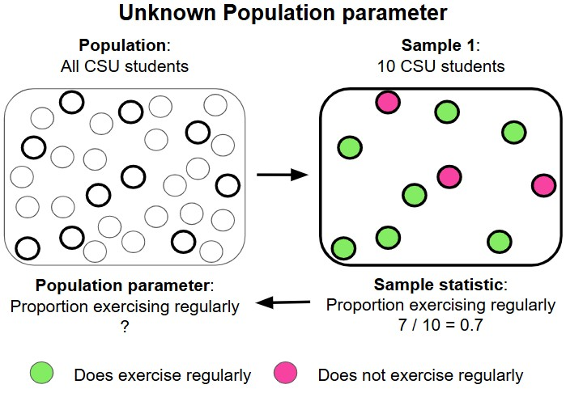
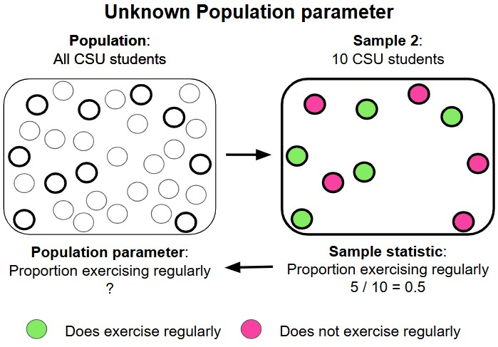
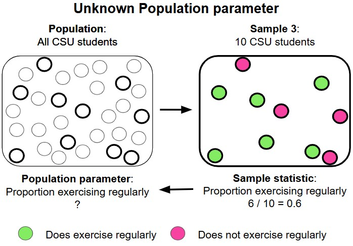
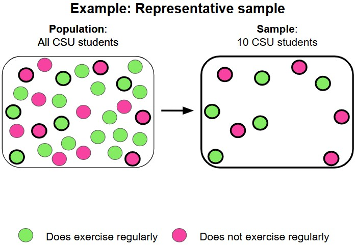
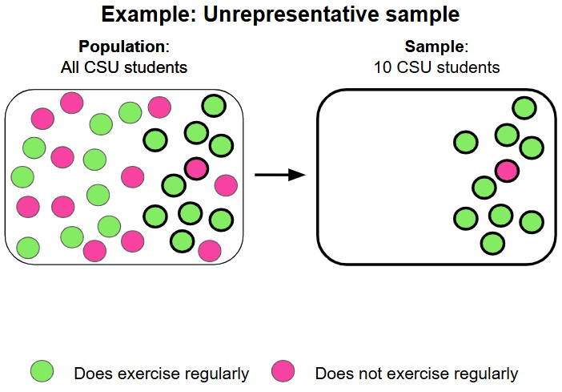

```{r}
#| echo: false
options(scipen = 999)
library(broom)
library(modelr)
library(janitor)
library(rsample)
library(tidyverse)
theme_set(theme_bw(base_size = 22))
```


```{r}
#| echo: false
plot_beta_prob <- function(value, alpha, beta, direction = "lower"){
  
  data <- data.frame(x = c(0, 1))
  
  p <- ggplot(data = data, aes(x)) +
    stat_function(
      fun = stats::dbeta,
      n = 101,
      args = list(shape1 = alpha, shape2= beta)
    ) +
    labs(
      x = expression(pi),
      y = "Density"
    )
  
  if(direction == "lower"){
    
  p <- p +
      stat_function(
        fun = dbeta, 
        args = list(alpha, beta), 
        geom = "area", 
        fill = "#D55E00", 
        alpha = 0.8,
        xlim = c(0, value)
      ) +
    labs(caption = paste0(
      "The area under the curve is ", 
      round(pbeta(value, alpha, beta), digits = 4)*100, "%.", 
      " In other words, P(", "\U03C0", " < ", value, ") = ", 
      round(pbeta(value, alpha, beta), digits = 4),"."
    ))
  }
  
  
  if(direction == "upper"){
    
  p <- p +
      stat_function(
        fun = dbeta, 
        args = list(alpha, beta), 
        geom = "area", 
        fill = "#D55E00", 
        alpha = 0.8, 
        xlim = c(value, 1)
      ) +
    labs(caption = paste0(
      "The area under the curve is ", 
      round(pbeta(value, alpha, beta, lower.tail = FALSE), digits = 4)*100, "%.", 
      " In other words, P(", "\U03C0", " > ", value, ") = ", 
      round(pbeta(value, alpha, beta, lower.tail = FALSE), digits = 4),"."
    ))
  }
  
p

}


plot_normal_prob <- function(value, mean, sd, end = 3, direction = "lower"){
  
  x <- seq(mean - (end * sd) , mean + (end * sd), 0.01)
  
  y <- dnorm(x, mean = mean, sd = sd)
  
  data <- data.frame(x = x, y = y)
  
  p <- ggplot(data = data, aes(x)) +
    stat_function(
      fun = stats::dnorm,
      n = 101,
      args = list(mean = mean, sd= sd)
    ) 
  
  if(direction == "lower"){
    
    p <- p +
      stat_function(
        fun = dnorm, 
        args = list(mean, sd), 
        geom = "area", 
        fill = "#D55E00", 
        alpha = 0.8,
        xlim = c(mean - (end*sd), value)
      ) +
      labs(
        caption = paste0(
          "The area under the curve is ",
          round(pnorm(value, mean, sd), digits = 4) * 100, 
          "%."
        )
      )
  }
  
  
  if(direction == "upper"){
    
    p <- p +
      stat_function(
        fun = dnorm, 
        args = list(mean, sd), 
        geom = "area", 
        fill = "#D55E00", 
        alpha = 0.8, 
        xlim = c(value, mean+(end * sd))
      ) +
      labs(
        caption = paste0(
          "The area under the curve is ", 
          round(pnorm(value, mean, sd, lower.tail = FALSE), digits = 4) * 100, 
          "%."
        )
      )
  }
  
  p
  
}
```


## Research questions

Every research project aims to answer a research question (or multiple questions).

::: {.callout-tip icon=false}
## Example
RQ: What proportion of CSUCI students exercise regularly?
::: 


## Population

The **population** for a research question is who/what we want to learn about.

::: {.callout-tip icon=false}
## Example

RQ: What proportion of **CSUCI students** exercise regularly?

Population: all CSUCI students

:::

## Sample

We typically do not have data on everyone in the population we want to learn about.

A **sample** is a subset of the population that you have data for

::: {.callout-tip icon=false}
## Example

RQ: What proportion of **CSUCI students** exercise regularly?

Population: all CSUCI students

Data: sample of 10 CSUCI students

:::

##

{fig-width=100%}

## 

{fig-width=100%}

## 

{fig-width=100%}


## Descriptive research question

If we had data on everyone in our population, then we can directly compute the quantity of interest, the **population parameter**

. . .

::: {.callout-tip icon=false}
## Example

RQ: What proportion of CSUCI students exercise regularly?

Population: all CSUCI students

Data: all CSUCI students

Population parameter: proportion of CSUCI students that exercise regularly

:::

## Inferential research question

If we can only get data for a subset of our population, a **sample**, then we can compute a **sample statistic**

We use the sample statistic to **infer** about the population parameter!

. . .


::: {.callout-tip icon=false}
## Example

RQ: What proportion of CSUCI students exercise regularly?

Population: all CSUCI students

Data: sample of 10 CSUCI students

Sample statistic: proportion of CSUCI students that do exercise regularly **in our sample**

:::


## 

{fig-width=100%}

## 

{fig-width=100%}

## The field of inferential statistics

The sample statistic is not a perfect estimate for the population parameter, it can vary from sample to sample

. . .

::: {.callout-tip icon=false}
## Example

RQ: What proportion of CSUCI students exercise regularly?

Population: all CSUCI students

Data: sample of 10 CSUCI students

Sample statistic: 0.7

Population parameter: 0.6

:::

## 

{fig-width=100%}

## 

{fig-width=100%}

## 

{fig-width=100%}

## 

{fig-width=100%}

##  The field of inferential statistics

The sample statistic is not a perfect estimate for the population parameter, it can vary from sample to sample

Statisticians have developed methods for inferring a population parameter with a measure of uncertainty

. . .

::: {.callout-tip icon=false}
## Example

RQ: What proportion of CSUCI students exercise regularly?

Inference: We estimate the proportion of CSUCI students that exercise regularly to be [*sample statistic*] plus or minus [*some margin of error*].

:::

. . .

Over the next couple of weeks we will be learning how to get a margin of error!

## Representative sample

Ideally, we want our sample to be representative of our population of interest, so we can have a better estimate for the population parameter

- To achieve this we want a **simple random sample** from our population, meaning everyone in the population had an equal chance of being in our sample

## 

{fig-width=100%}

## 

{fig-width=100%}

# Sampling variability

We've discussed:

- population versus sample
- population parameter versus sample statistic
- the idea that we want to use a sample statistic as an estimate for an unknown population parameter

Now we will investigate how much a sample statistic can vary from sample to sample

## Data

We will revisit the LA Police Department payroll data, but only focus projected annual salary for full time workers in 2018:

```{r}
lapd <- read_csv("https://csuci-data200-spring2026.github.io/lectures/data/Police_Payroll.csv") |> 
  clean_names() |> 
  filter(year == 2018 & employment_type == "Full Time") |> 
  select(row_id, projected_annual_salary, job_class_title) |> 
  mutate(over_100k = case_when(
    projected_annual_salary > 100000 ~ TRUE,
    projected_annual_salary <= 100000 ~ FALSE
  ))

glimpse(lapd)
```

# What proportion of full time workers in the LAPD in 2018 made over $100,000?

## Study components

**Research question**: What proportion of full time workers in the LAPD  in 2018 made over $100,000?

**Population of interest**:  


**Population parameter**: 


## Study components

**Research question**: What proportion of full time workers in the LAPD in 2018 made over $100,000?

**Population of interest**: people working full time for the LAPD in 2018

**Population parameter**: proportion of people working full time for the LAPD in 2018 that made over $100,000


## Population parameter

**Population parameter**: proportion of people working full time for the LAPD in 2018 that made over $100,000

Since we have data for everyone in our population of interest, we can calculate the population proportion:

```{r}
lapd |> 
  summarize(sample_prop_over_100k = sum(over_100k == TRUE) / n()) 
```

. . .

```{r}
#| echo: false

pop_prop <- 
  lapd |> 
  summarize(sample_prop_over_100k = sum(over_100k == TRUE) / n()) |> 
  pull(sample_prop_over_100k) |> 
  round(digits = 3)
```


Population proportion = `r pop_prop`

## Sampling

In reality, we often do not have data for everyone in our population of interest, so we collect a sample instead. 


We will use the `rep_sample_n()` function from the `infer` package to randomly sample 50 people

```{r}
library(infer)

set.seed(20260420)

rep_sample_n(lapd, size = 50)
```

## Sample 1

```{r}
sample_1 <- rep_sample_n(lapd, size = 50)

sample_1 |> 
  summarize(sample_prop_over_100k = sum(over_100k == TRUE) / n()) 
```

```{r}
#| echo: false

sample_prop_1 <- sample_1 |> 
  summarize(sample_prop_over_100k = sum(over_100k == TRUE) / n()) |> 
  pull(sample_prop_over_100k) 
```

With our sample of 50 people we get a sample proportion of `r sample_prop_1`, meaning `r sample_prop_1 * 100`% of people in our sample made over 100k.

. . .

The population proportion was `r pop_prop`. The sample gave us a similar value, but not quite the same.

## Sample 2

Suppose we were to randomly sample 50 people from the LAPD again:

```{r}
sample_2 <- rep_sample_n(lapd, size = 50)

sample_2 |> 
  summarize(sample_prop_over_100k = sum(over_100k == TRUE) / n()) 
```

. . .

This sample proportion is even further away from the actual population proportion of `r pop_prop`!

## Sample 3

Suppose we were to randomly sample 50 people from the LAPD a third time:

```{r}
sample_3 <- rep_sample_n(lapd, size = 50)

sample_3 |> 
  summarize(sample_prop_over_100k = sum(over_100k == TRUE) / n()) 
```

. . .

This time we over estimated the population proportion of `r pop_prop`!

<!-- ## Sample 4 -->

<!-- Suppose we were to randomly sample 50 people from the LAPD a fourth time: -->

<!-- ```{r} -->
<!-- sample_4 <- rep_sample_n(lapd, size = 50) -->

<!-- sample_4 |>  -->
<!--   summarize( -->
<!--     sample_prop_over_100k = sum(over_100k == TRUE) / n() -->
<!--   )  -->
<!-- ``` -->

<!-- ## Sample 5 -->

<!-- Suppose we were to randomly sample 50 people from the LAPD a fourth time: -->

<!-- ```{r} -->
<!-- sample_5 <- rep_sample_n(lapd, size = 50) -->

<!-- sample_5 |>  -->
<!--   summarize( -->
<!--     sample_prop_over_100k = sum(over_100k == TRUE) / n() -->
<!--   )  -->
<!-- ``` -->

## Sampling variability

```{r}
#| echo: false
sample_prop_2 <- sample_2 |> 
  summarize(sample_prop_over_100k = sum(over_100k == TRUE) / n()) |> 
  pull(sample_prop_over_100k) 

sample_prop_3 <- sample_3 |> 
  summarize(sample_prop_over_100k = sum(over_100k == TRUE) / n()) |> 
  pull(sample_prop_over_100k) 
# 
# sample_prop_4 <- sample_4 |> 
#   summarize(
#     sample_prop_over_100k = sum(over_100k == TRUE) / nrow(sample_1)
#   ) |> 
#   pull(sample_prop_over_100k) 
# 
# sample_prop_5 <- sample_5 |> 
#   summarize(
#     sample_prop_over_100k = sum(over_100k == TRUE) / nrow(sample_1)
#   ) |> 
#   pull(sample_prop_over_100k) 
```

While our population proportion of people that made over 100k stayed the same: `r pop_prop`, our sample proportions varied:

| Sample | Sample Proportion |
|:-------|:---------------|
| 1 | `r sample_prop_1` |
| 2 | `r sample_prop_2` |
| 3 | `r sample_prop_3` |
| ... | ... |

This is called **sampling variability**!

## Sample proportion

If we can't expect the proportion from our sample to be exactly equal to the true population proportion due to sampling variability:

> How can we trust our sample proportion to infer the population proportion?

. . .

We can use simulations to draw a bunch of samples and examine the distribution of the proportions from each sample

## Simulating many samples

The `reps` argument of the `rep_sample_n()` function allows us to simulate drawing 20,000 samples, each with 50 people

```{r}
lapd_samples <- rep_sample_n(lapd, size = 50, reps = 20000)

lapd_samples
```

## Simulating many samples

The `reps` argument of the `rep_sample_n()` function allows us to simulate drawing 20,000 samples, each with 50 people


```{r}
tail(lapd_samples)
```


## Sample proportions from 20,000 samples

```{r}
lapd_samples <-
  lapd_samples |> 
  group_by(replicate) |>
  summarize(sample_prop_over_100k = sum(over_100k == TRUE) / n())

lapd_samples
```

## Sample proportions from 20,000 samples

```{r}
ggplot(lapd_samples, aes(x = sample_prop_over_100k)) +
  geom_histogram(bins = 15)
```

## Sample proportions from 20,000 samples

```{r}
#| fig-align: center
ggplot(lapd_samples, aes(x = sample_prop_over_100k)) +
  geom_histogram(bins = 15) +
  geom_vline(xintercept = 0.642, color = "red")
```

## Sampling distribution ($n$ = 50)

The **sampling distribution** is the distribution of our estimate for all samples of a given size ($n$)

```{r}
#| echo: false
#| fig-align: center
ggplot(lapd_samples, aes(x = sample_prop_over_100k)) +
  geom_histogram(bins = 15) +
  geom_vline(
    xintercept = 0.642,
    color = "red"
  )
```

## Features of the sampling distribution

```{r}
lapd_samples |> 
  summarize(mean = mean(sample_prop_over_100k), sd = sd(sample_prop_over_100k))
```

. . .

The mean of the proportions we got from each sample is almost equal to the population proportion (0.642)!

```{r}
#| echo: false
#| fig-align: center
#| out-width: "500px"
#| out-height: "300px"
ggplot(lapd_samples, aes(x = sample_prop_over_100k)) +
  geom_histogram(bins = 15) +
  geom_vline(
    xintercept = 0.642,
    color = "red"
  )
```

## $n = 200$

We chose to only sample 50 people each time, but why not 200?

. . .

```{r}
lapd_samples_200 <- rep_sample_n(lapd, size = 200, reps = 20000) |> 
  group_by(replicate) |>
  summarize(sample_prop_over_100k = sum(over_100k == TRUE) / n())
```

```{r}
#| echo: false
#| fig-align: center
#| out-width: "800px"
#| out-height: "300px"

prop_samples <- 
  mutate(lapd_samples, n = "n = 50") |> 
  bind_rows(mutate(lapd_samples_200, n = "n = 200")) |> 
  mutate(n = factor(n, levels = c("n = 50","n = 200")))

ggplot(prop_samples, aes(x = sample_prop_over_100k)) +
  geom_histogram(bins = 15) +
  geom_vline(
    xintercept = 0.642,
    color = "red"
  ) +
  facet_wrap(~ n, nrow = 1)
```

## Changing $n$

```{r}
#| echo: false
#| fig-align: center

lapd_samples_20 <- rep_sample_n(lapd, size = 20, reps = 20000) |> 
  group_by(replicate) |>
  summarize(sample_prop_over_100k = sum(over_100k == TRUE) / n())

lapd_samples_1000 <- rep_sample_n(lapd, size = 1000, reps = 20000) |> 
  group_by(replicate) |>
  summarize(sample_prop_over_100k = sum(over_100k == TRUE) / n())

prop_samples <- 
  prop_samples |> 
  bind_rows(mutate(lapd_samples_20, n = "n = 20")) |> 
  bind_rows(mutate(lapd_samples_1000, n = "n = 1000")) |> 
  mutate(n = factor(
    n, 
    levels = c("n = 20", "n = 50", "n = 200", "n = 1000")
  ))

ggplot(prop_samples, aes(x = sample_prop_over_100k)) +
  geom_histogram(bins = 15) +
  geom_vline(
    xintercept = 0.642,
    color = "red"
  ) +
  facet_wrap(~ n, nrow = 1)
```

As we increase the number of people in each sample ("sample size" $n$), the standard deviation of our sample proportions decreases!

## Review of sampling distributions for a proportion

- The mean of our sample proportions is approximately the true population proportion
- Increasing our sample size decreases the variability of our sample proportions

# Sampling distibution for a mean

Up until now we have been focused on studying how much a sample proportion can vary from sample to sample. Sample proportions are useful for research questions concerning categorical variables

Now we will study how much a sample mean varies from sample to sample. Sample means are useful for research questions concerning numerical variables.

## Study components

**Research question**: How much did full time workers in the LAPD in 2018 make, on average?

**Population of interest**: 

**Population parameter**: 

## Study components

**Research question**: How much did full time workers in the LAPD in 2018 make, on average?

**Population of interest**: people working full time for the LAPD in 2018

**Population parameter**: mean salary of people working full time for the LAPD in 2018

## Salary


```{r}
ggplot(lapd, aes(x = projected_annual_salary)) +
  geom_histogram()
```

## Population mean

```{r}
lapd |> 
  summarize(mean_salary = mean(projected_annual_salary))
```

So the population proportion (population mean in this case) salary is $103,127.

## Mean salary for a single sample of 50 people

```{r}
lapd_sample <- rep_sample_n(lapd, size = 50)

lapd_sample |> 
  summarize(mean = mean(projected_annual_salary))
```

```{r}
#| echo: false

pop_mean <- lapd |> 
  summarize(mean_salary = mean(projected_annual_salary))

sample_mean <- lapd_sample |> 
  summarize(mean = mean(projected_annual_salary))
```

## Sampling distribution for the mean $n = 50$

```{r}
lapd_samples <- rep_sample_n(lapd, size = 50, reps = 20000) |> 
  group_by(replicate) |> 
  summarize(salary_sample_means = mean(projected_annual_salary))

ggplot(lapd_samples, aes(x = salary_sample_means)) +
  geom_histogram() +
  geom_vline(xintercept = 103127.27, color = "red")
```

## Features of our sampling distribution

```{r}
lapd_samples |> 
  summarize(mean = mean(salary_sample_means), sd = sd(salary_sample_means))
```


. . .

The mean of the means we got from each sample is almost equal to the population mean ($103,127.27)!

```{r}
#| echo: false
#| fig-align: center
#| out-width: "500px"
#| out-height: "300px"
ggplot(lapd_samples, aes(x = salary_sample_means)) +
  geom_histogram() +
  geom_vline(xintercept = 103127.27, color = "red")
```


## Sampling distributions for the mean with different $n$

```{r}
#| echo: false
#| fig-align: center

lapd_samples_20 <- rep_sample_n(lapd, size = 20, reps = 20000) |> 
  group_by(replicate) |> 
  summarize(salary_sample_means = mean(projected_annual_salary))

lapd_samples_200 <- rep_sample_n(lapd, size = 200, reps = 20000) |> 
  group_by(replicate) |> 
  summarize(salary_sample_means = mean(projected_annual_salary))

lapd_samples_1000 <- rep_sample_n(lapd, size = 1000, reps = 20000) |> 
  group_by(replicate) |> 
  summarize(salary_sample_means = mean(projected_annual_salary))

lapd_samples |> 
  mutate(n = "n = 50") |> 
  bind_rows(mutate(lapd_samples_20, n = "n = 20")) |>
  bind_rows(mutate(lapd_samples_200, n = "n = 200")) |>
  bind_rows(mutate(lapd_samples_1000, n = "n = 1000")) |> 
  mutate(n = factor(
    n, 
    levels = c("n = 20", "n = 50", "n = 200", "n = 1000")
  )) |> 
  ggplot(aes(x = salary_sample_means)) +
  geom_histogram(bins = 15) +
  geom_vline(xintercept = 103127.27,color = "red") +
  facet_wrap(~ n, nrow = 1) +
  scale_x_continuous(n.breaks = 5) +
  theme(axis.text.x = element_text(angle = 90, vjust = 0.5, hjust = 1))
```


